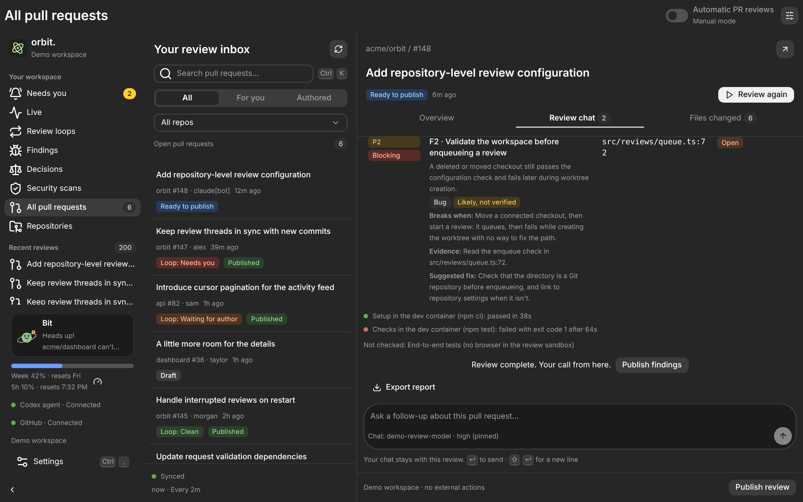
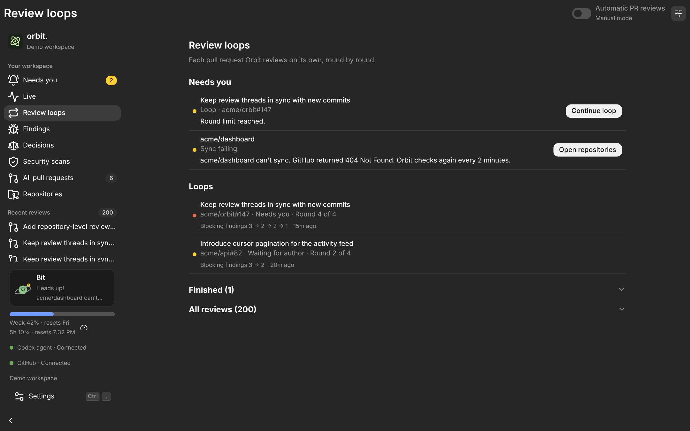
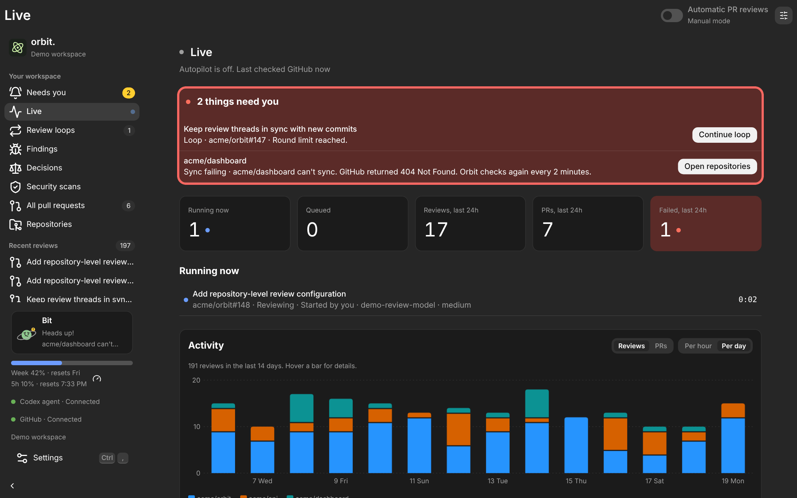
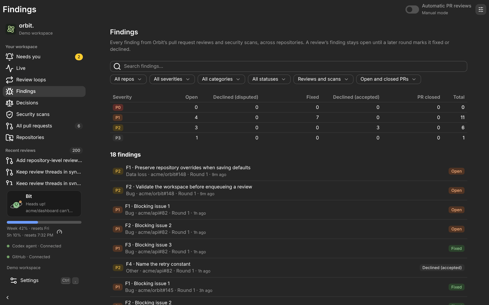
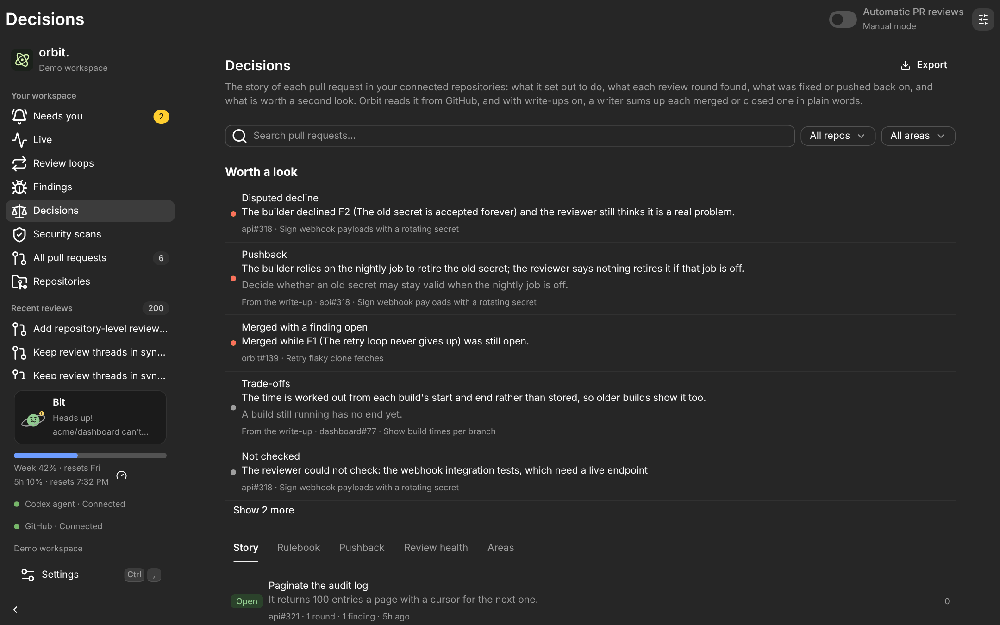
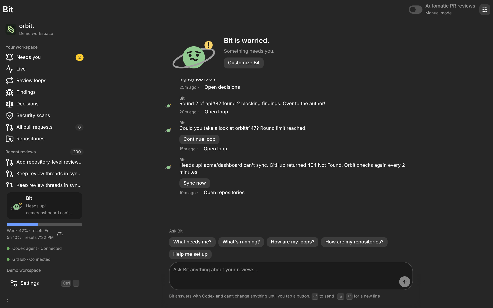
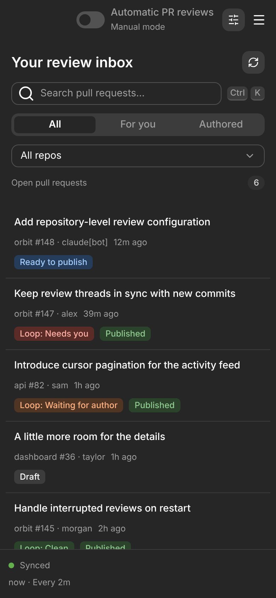

<p align="center">
  
</p>

<h1 align="center">Orbit</h1>

<p align="center">
  <strong>A reviewer for your pull requests that keeps going until they're clean.</strong><br />
  Runs on your computer, reviews with the AI coding tools you already use, and only calls you when something needs you.
</p>

<p align="center">
  <a href="https://github.com/analogproblems/orbit/releases/latest">Download</a> ·
  <a href="docs/user-guide.md">User guide</a> ·
  <a href="docs/architecture.md">How it works</a>
</p>



A coding agent or a person opens a pull request. Orbit reviews its latest commit with **Codex**, **Claude** or **Antigravity**, in a separate copy of your repository, and posts what it found on GitHub. The author fixes or pushes back on each finding and pushes again. Orbit reviews the new commit, picking up from what it found before, and the loop repeats until nothing blocking is left.

Orbit is a desktop app for Linux, macOS and Windows, built with Tauri, Rust and React. It uses the command-line tools you already have signed in, so it never asks for or stores your tokens.

## What it does

### Reviews that read like a good colleague's

Every finding has a priority from P0 to P3, the places it shows up, a concrete case where it breaks, the evidence, a suggested fix and how to tell it's fixed. Findings keep short IDs like **F2** across rounds, so the author can reply `Fixed F2 in abc1234` or `Declined F2: intended` and Orbit checks the claim on the next round. Read the review in Orbit, ask follow-up questions in its chat, and publish it when you're happy, or let Orbit publish on its own.

### Loops that run themselves



Turn on **Autopilot** and Orbit reviews every new push by itself. Each pull request becomes a loop you can follow round by round, with its blocking findings shrinking as it goes (`3 → 2 → 1`). Loops stop at a round limit you set, and Orbit tells you when one stalls, when the reviewer disputes a pushback, or when a review fails.

### Everything at a glance



**Live** shows what needs you, what's running, and how busy each repository has been over the last day or two weeks. A usage meter in the sidebar shows how much of your Codex allowance is left.

### Every finding, in one place



**Findings** gathers every finding from every review and security scan across your repositories. Search and filter them by repository, priority, kind and status, and open one to see its history round by round. **Security scans** runs OpenAI's Codex Security plugin over a whole repository, and its findings land here too.

### The story behind each pull request



**Decisions** reads each pull request's history from GitHub and tells its story: what it set out to do, what each round found, what was fixed or pushed back on, and what deserves a second look, such as a merge with a finding still open. Turn on write-ups and Codex or Claude sums up each finished pull request in plain words, and builds a rulebook of what your app now commits to from the merged ones. Export it all as Markdown.

### Meet Bit



Bit is Orbit's buddy, a small planet at the bottom of the sidebar. It notes each round and each clean loop, its face shows how things are going, and it offers a button when one of Orbit's own controls can fix a problem. Ask it what needs you or what's running, or type any question. **Help me set up** walks you through connecting your first repository, one tap per step. Bit can answer with Codex, Claude, Antigravity, Ollama or an API key, and you can rename it, pick its colour and give it a hat.

### Take it with you



Open the same workspace from your phone or laptop over [Tailscale](https://tailscale.com) while Orbit runs on your computer. Approvals, loops, publishing and chat all work there, and the layout fits a phone.

### Built with care for your machine

- **Each review runs in its own copy** of your repository, inside the reviewer's sandbox, with network access off unless you turn it on.
- **Dev containers** can run a repository's setup and tests in a box with no access to your files, sign-ins or network, built from the base branch's recipe and never the pull request's.
- **Only trusted pull requests are reviewed automatically**: those from a branch in the repository by an owner, member, collaborator, or an account you trust. Drafts and forks never are.
- **A credential scan** stops a report that looks like it contains a secret from being published on its own.
- **Orbit never approves, requests changes or merges.** Its reviews are plain comments, and Autopilot and automatic publishing both start off.

Read [Isolation and its limits](docs/architecture.md#isolation-and-its-limits) before turning on automatic reviews: a sandbox is not a full boundary.

<br clear="right" />

## Try it

**See it first.** Run the browser demo with sample data and simulated reviews. It can't reach your repositories or post anything.

```sh
npm install
npm run dev   # then open http://127.0.0.1:1420
```

**Install it.** Download the installer for your system from the [latest release](https://github.com/analogproblems/orbit/releases/latest): `.deb`, `.AppImage` or `.rpm` for Linux, `.dmg` for macOS (Apple silicon and Intel), and `.msi` or `.exe` for Windows. The macOS and Windows builds aren't signed yet: on macOS, open it once, then choose **Open Anyway** in **System Settings → Privacy & Security**; on Windows, choose **More info → Run anyway**.

You'll also need, signed in:

- [Git](https://git-scm.com/) and the [GitHub CLI](https://cli.github.com/) (`gh`).
- The Codex CLI (`codex`, tested with 0.156.1).
- Optionally [Claude Code](https://code.claude.com/docs) (`claude`) or the [Antigravity CLI](https://antigravity.google/docs/cli/install/) (`agy`), to review a repository with them instead.
- Optionally [Docker](https://docs.docker.com/get-started/get-docker/) and the [Dev Container CLI](https://github.com/devcontainers/cli), to run setup and checks in a dev container.

If Orbit can't find these tools when you open it from a desktop shortcut, launch it from a terminal where they work.

### Your first review

1. Open **Settings** and check that GitHub and Codex show **Connected**.
2. Open **Repositories → Add repository**, or ask Bit to **Help me set up**. Pick a repository and point Orbit at your local copy, or leave the path empty and Orbit keeps its own.
3. Open **All pull requests**, pick one, and click **Start review**. Follow it in **Review chat**, then **Publish review** to post it.
4. When you're ready for the loop, turn on **Automatic reviews** for the repository and **Autopilot** in the header.

For a coding agent on the other side of the loop, copy the [`answer-orbit-reviews`](.claude/skills/answer-orbit-reviews/SKILL.md) Claude Code skill from Settings into your repository. It teaches the agent to read Orbit's findings and answer them in a form Orbit understands.

The [user guide](docs/user-guide.md) covers every page, setting and rule.

## Build from source

You'll need Node.js 22.12 or newer, stable Rust, and the [Tauri prerequisites](https://v2.tauri.app/start/prerequisites/) for your system.

```sh
npm install
npm run desktop   # the desktop app, with hot reload
npm run check     # everything the project checks before a change
```

[CONTRIBUTING.md](CONTRIBUTING.md) has the full list of commands, the dev container, and how releases are made. [docs/architecture.md](docs/architecture.md) explains how Orbit fits together.

## Contributing and license

Bug reports and ideas are welcome as [issues](https://github.com/analogproblems/orbit/issues); [CONTRIBUTING.md](CONTRIBUTING.md) explains how. Please report security problems privately, as [SECURITY.md](SECURITY.md) describes. Orbit is released under the [Apache License 2.0](LICENSE).
