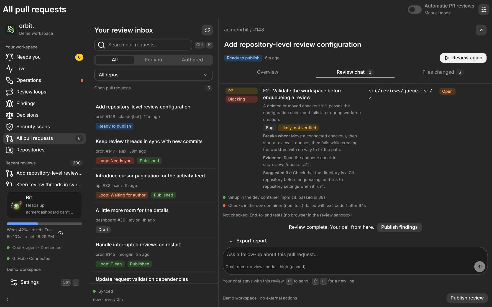
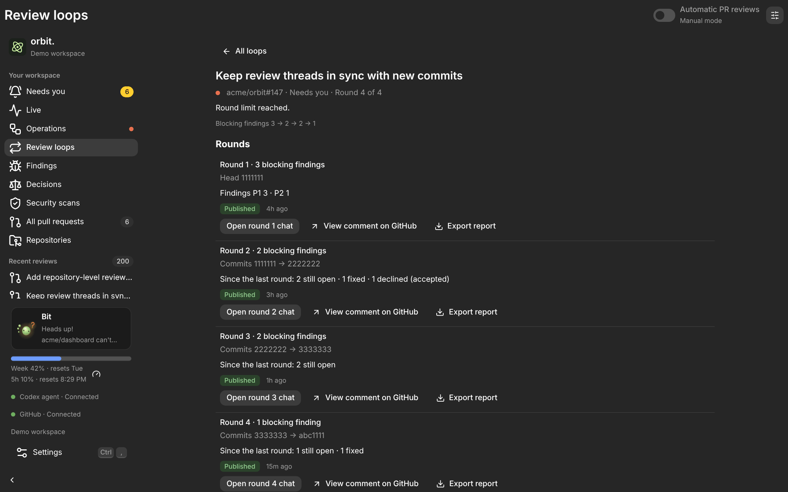
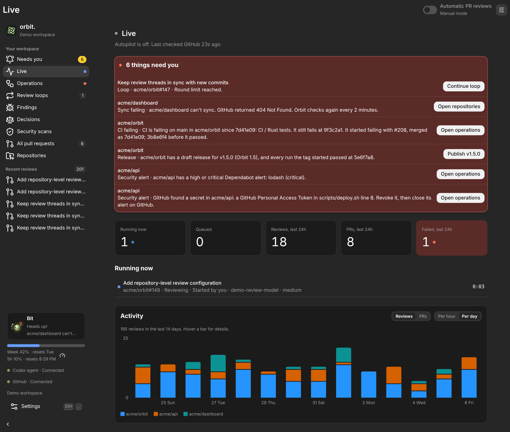
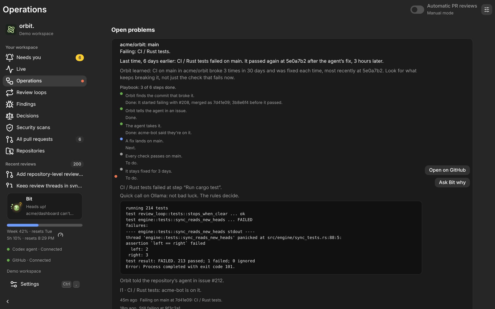
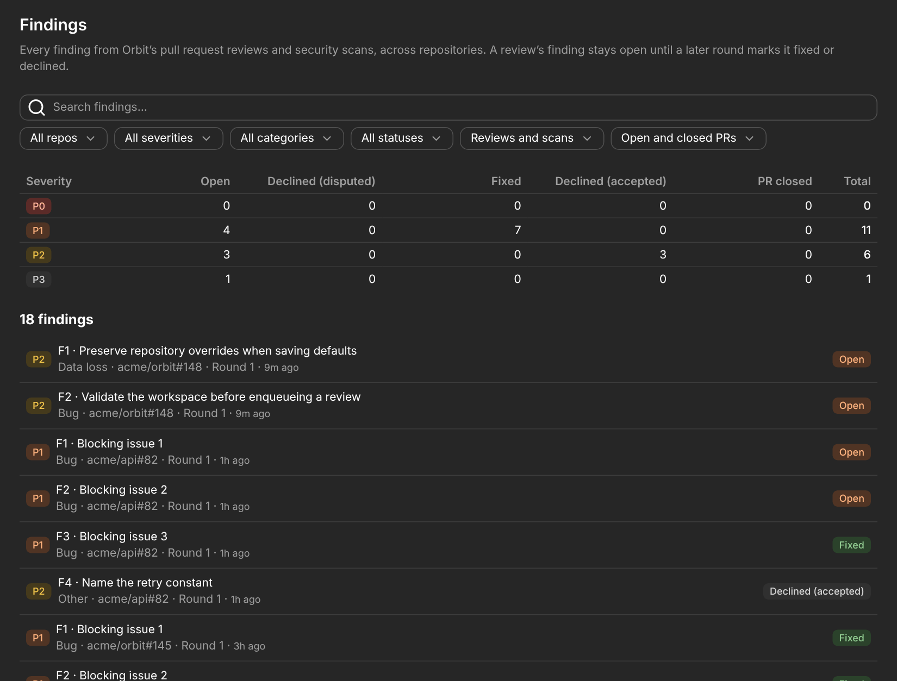
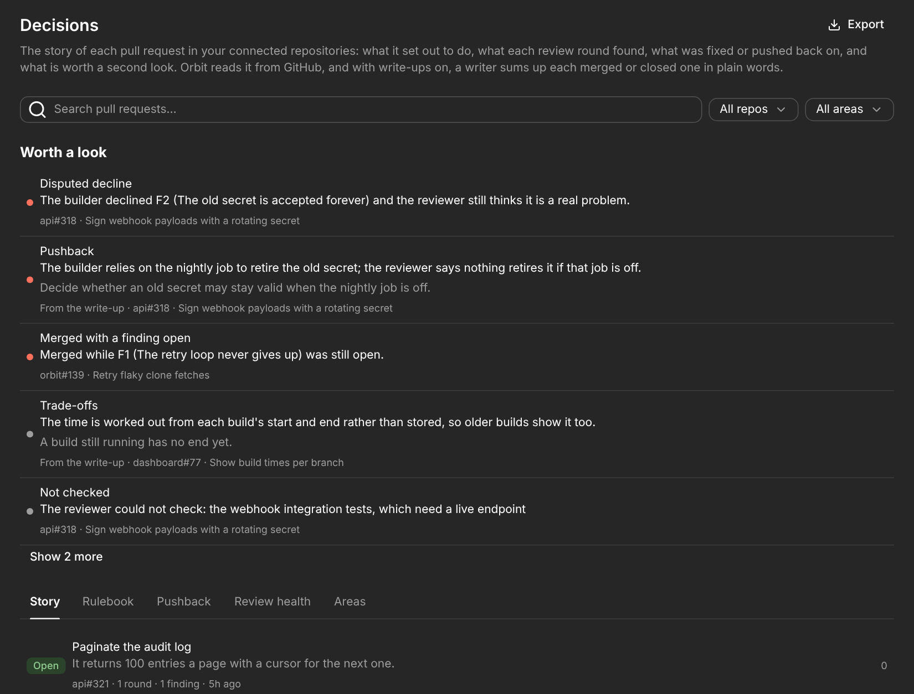
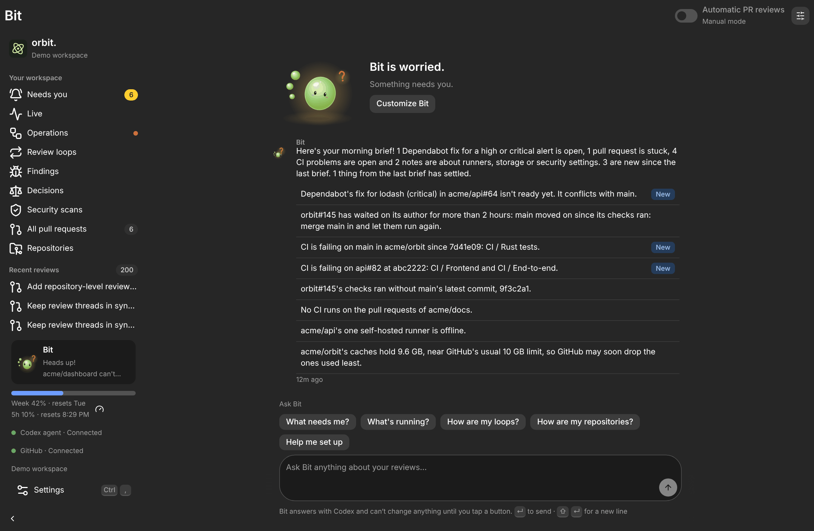
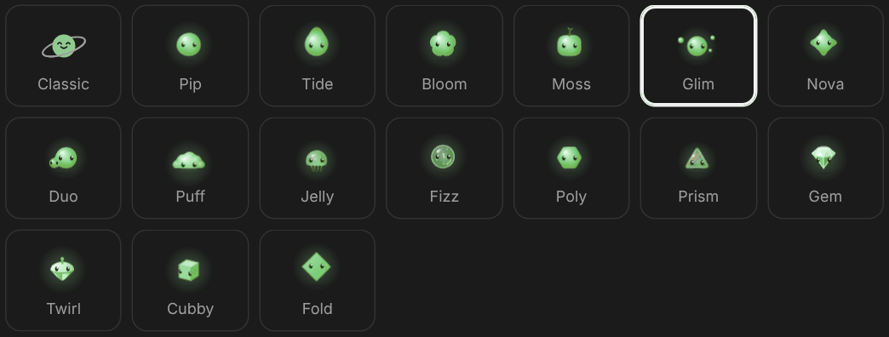
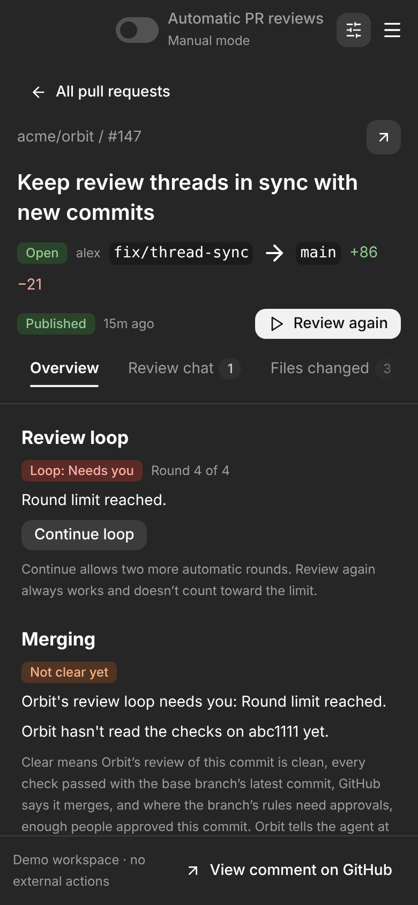

<p align="center">
  
</p>

<h1 align="center">Orbit</h1>

<p align="center">
  <strong>A reviewer for your pull requests that keeps going until they're clean.</strong><br />
  It runs on your computer, reviews with the AI coding tools you already use, and only calls you when something needs you.
</p>

<p align="center">
  <a href="https://github.com/analogproblems/orbit/releases/latest">Download</a> ·
  <a href="CHANGELOG.md">What's new</a> ·
  <a href="docs/user-guide.md">User guide</a> ·
  <a href="docs/architecture.md">How it works</a>
</p>



## How it works

1. **A pull request opens**, from a coding agent or a person.
2. **Orbit reviews it** with **Codex**, **Claude** or **Antigravity**, in its own copy of your repository, and posts what it found on GitHub.
3. **The author answers** each finding, fixing it or saying why not, and pushes again.
4. **Orbit looks again**, picking up where it left off, until nothing blocking is left.

Every finding has a priority, a case where it breaks, the evidence and a suggested fix. Ask follow-up questions in the chat, then publish the review when you're happy, or let Orbit publish on its own.

Orbit is a desktop app for Linux, macOS and Windows. It uses the command-line tools you already have signed in, so it never asks for your tokens.

## A look around

### Loops that run themselves

Turn on **Autopilot** and Orbit reviews every new push by itself. Follow each pull request round by round as its blocking findings shrink, and step in only when a loop needs you.



### Everything at a glance

**Live** shows what needs you, what's running now, and how busy each repository has been. Most things come with a button, so you can act on them right there.



### CI, security and releases, looked after

**Operations** keeps an eye on the rest of each repository. It says why a check failed and which commit broke it, tells the project's agent what to fix, and ticks off each step until the fix holds. It also watches security alerts, risky workflow settings and releases, and can publish a release with your tap.



### Every finding, and the story behind it

<table>
  <tr>
    <td width="50%"></td>
    <td width="50%"></td>
  </tr>
  <tr>
    <td><strong>Findings</strong> gathers every finding from every review and security scan, across all your repositories.</td>
    <td><strong>Decisions</strong> tells each pull request's story, and points out what deserves a second look.</td>
  </tr>
</table>

### Meet Bit

Bit is Orbit's buddy. It sends you a morning brief, tells you when a loop is clean or stuck, and answers your questions. When one of Orbit's own controls can fix a problem, Bit offers a button. Bit can answer with Codex, Claude, Antigravity, Ollama or an API key.



Give it a name, a look, a colour and a hat.



### Take it with you



Open Orbit from your phone or laptop over [Tailscale](https://tailscale.com) while it runs on your computer. Everything works there, and notifications reach your phone even with the page closed.

To keep reviewing while your laptop is closed, [run `orbit-server`](docs/user-guide.md#run-orbit-without-a-window) on a computer that stays on. The desktop app can show that Orbit instead of running its own, and move your repositories and history across.

### Careful by default

- **Each review runs in its own copy** of your repository, inside the reviewer's sandbox.
- **Only trusted pull requests are reviewed on their own**: those from a branch in the repository by an owner, member, collaborator, or an account you trust. Drafts and forks never are.
- **A report that looks like it holds a secret** is never published on its own.
- **Orbit never approves, requests changes or merges.** Its reviews are plain comments, and Autopilot starts off.

Read [Isolation and its limits](docs/architecture.md#isolation-and-its-limits) before turning on automatic reviews: a sandbox is not a full boundary.

<br clear="right" />

## Try it

**See it first.** Run the browser demo. It has sample pull requests and simulated reviews, and can't reach your repositories or post anything.

```sh
npm install
npm run dev   # then open http://127.0.0.1:1420
```

**Install it.** Download the installer for your system from the [latest release](https://github.com/analogproblems/orbit/releases/latest): `.deb`, `.AppImage` or `.rpm` for Linux, `.dmg` for macOS (Apple silicon and Intel), and `.msi` or `.exe` for Windows. The macOS and Windows builds aren't signed yet: on macOS, open it once, then choose **Open Anyway** in **System Settings → Privacy & Security**; on Windows, choose **More info → Run anyway**.

You'll also need, signed in:

- [Git](https://git-scm.com/) and the [GitHub CLI](https://cli.github.com/) (`gh`).
- The Codex CLI (`codex`, tested with 0.156.1).
- Optionally [Claude Code](https://code.claude.com/docs) (`claude`) or the [Antigravity CLI](https://antigravity.google/docs/cli/install/) (`agy`), to review with them instead.
- Optionally [Docker](https://docs.docker.com/get-started/get-docker/) and the [Dev Container CLI](https://github.com/devcontainers/cli), to run a repository's setup and checks in a dev container.

If Orbit can't find these tools when you open it from a desktop shortcut, launch it from a terminal where they work.

### Your first review

1. Open **Settings** and check that GitHub and Codex show **Connected**.
2. Open **Repositories → Add repository**, or ask Bit to **Help me set up**.
3. Open **All pull requests**, pick one, and click **Start review**. Follow it in **Review chat**, then **Publish review** to post it.
4. When you're ready for the loop, turn on **Automatic reviews** for the repository and **Autopilot** in the header.

For a coding agent on the other side of the loop, copy the [`answer-orbit-reviews`](.claude/skills/answer-orbit-reviews/SKILL.md) Claude Code skill from Settings into your repository. It teaches the agent to answer Orbit's findings in a form Orbit understands.

The [user guide](docs/user-guide.md) covers every page, setting and rule.

## Build from source

You'll need Node.js 22.12 or newer, stable Rust, and the [Tauri prerequisites](https://v2.tauri.app/start/prerequisites/) for your system.

```sh
npm install
npm run desktop   # the desktop app, with hot reload
npm run check     # everything the project checks before a change
```

[CONTRIBUTING.md](CONTRIBUTING.md) has the full list of commands, the dev container, and how releases are made.

## Contributing and license

Bug reports and ideas are welcome as [issues](https://github.com/analogproblems/orbit/issues); [CONTRIBUTING.md](CONTRIBUTING.md) explains how. Please report security problems privately, as [SECURITY.md](SECURITY.md) describes. Orbit is released under the [Apache License 2.0](LICENSE).
